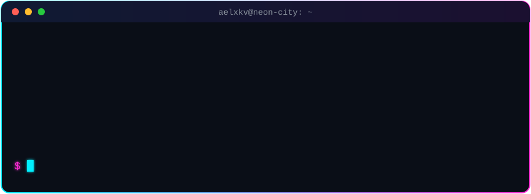

## About

Hi, I'm Alex, a B.Tech CSE student in Kerala. I like building things (Discord bots, a roleplay game server, small web apps), and I'm slowly steering towards security, mainly blue team work.

Most of my code gets written on an Android phone in Termux. Heavier stuff, like analysis VMs for security labs, runs on my laptop.

<div align="center">
  
</div>

**What I'm up to right now**

- Working through blue team labs on CyberDefenders (PCAP forensics)
- Writing data structures in C ([dsa-in-c](https://github.com/aelxkv/dsa-in-c))
- Moving Neon City, my roleplay server, from SA-MP to open.mp
- Building Skipzy, an attendance app for college students

---

## Projects

| Project | What it is | Stack |
|---|---|---|
| [Discord Leveling / XP Bot](https://github.com/aelxkv/Discord-Leveling-Or-XP-Bot-Source-Code) | XP and levels for Discord servers | JavaScript |
| [dsa-in-c](https://github.com/aelxkv/dsa-in-c) | Data structures and algorithms written from scratch in C | C |
| [Safe-Share](https://github.com/aelxkv/Safe-Share-) | A web app for sharing files and information safely | HTML |
| Neon City Roleplay | A SA-MP / open.mp roleplay server, split into modules | Pawn, MySQL |
| RandomChat | A random chat web app, later turned into a PWA | React, Supabase |
| Skipzy | Attendance tracker with a "can I bunk?" check for college students | In progress |

<details>
<summary>Tools I use</summary>
<br/>


</details>

---

## Recent activity

<!--ACTIVITY:START-->
- `2026-11-21` Pushed code to [aelxkv/aelxkv](https://github.com/aelxkv/aelxkv)
- `2026-11-21` Opened an issue in [aelxkv/aelxkv](https://github.com/aelxkv/aelxkv)
- `2026-11-20` Pushed code to [aelxkv/aelxkv](https://github.com/aelxkv/aelxkv)
- `2026-11-18` Pushed code to [aelxkv/aelxkv](https://github.com/aelxkv/aelxkv)
- `2026-11-10` Pushed code to [aelxkv/git-collab-challenge](https://github.com/aelxkv/git-collab-challenge)
- `2026-11-10` Pushed code to [aelxkv/feedback-portal](https://github.com/aelxkv/feedback-portal)
<!--ACTIVITY:END-->

---

## Play tic-tac-toe with me

Every square is a link. Clicking one opens a GitHub issue, a small script plays your move, the bot answers, and this board updates. You need a GitHub account to play. The bot isn't perfect, so you can beat it.

<!--TTT:START-->
| | | |
|:-:|:-:|:-:|
| [·](https://github.com/aelxkv/aelxkv/issues/new?title=ttt%7Cmove%7C0&body=Just%20press%20%27Submit%20new%20issue%27.%20Please%20don%27t%20edit%20the%20title.) | [·](https://github.com/aelxkv/aelxkv/issues/new?title=ttt%7Cmove%7C1&body=Just%20press%20%27Submit%20new%20issue%27.%20Please%20don%27t%20edit%20the%20title.) | [·](https://github.com/aelxkv/aelxkv/issues/new?title=ttt%7Cmove%7C2&body=Just%20press%20%27Submit%20new%20issue%27.%20Please%20don%27t%20edit%20the%20title.) |
| [·](https://github.com/aelxkv/aelxkv/issues/new?title=ttt%7Cmove%7C3&body=Just%20press%20%27Submit%20new%20issue%27.%20Please%20don%27t%20edit%20the%20title.) | [·](https://github.com/aelxkv/aelxkv/issues/new?title=ttt%7Cmove%7C4&body=Just%20press%20%27Submit%20new%20issue%27.%20Please%20don%27t%20edit%20the%20title.) | [·](https://github.com/aelxkv/aelxkv/issues/new?title=ttt%7Cmove%7C5&body=Just%20press%20%27Submit%20new%20issue%27.%20Please%20don%27t%20edit%20the%20title.) |
| [·](https://github.com/aelxkv/aelxkv/issues/new?title=ttt%7Cmove%7C6&body=Just%20press%20%27Submit%20new%20issue%27.%20Please%20don%27t%20edit%20the%20title.) | [·](https://github.com/aelxkv/aelxkv/issues/new?title=ttt%7Cmove%7C7&body=Just%20press%20%27Submit%20new%20issue%27.%20Please%20don%27t%20edit%20the%20title.) | [·](https://github.com/aelxkv/aelxkv/issues/new?title=ttt%7Cmove%7C8&body=Just%20press%20%27Submit%20new%20issue%27.%20Please%20don%27t%20edit%20the%20title.) |

Your turn. You're **X**, the bot is **O**. Click a **·** to play.  
Score so far: visitors **0**, bot **0**, draws **0**
<!--TTT:END-->

---

## Numbers

<div align="center">


</div>

---

## Get in touch

[LinkedIn](https://www.linkedin.com/in/aelxkv) · [Email](mailto:aelxkv@gmail.com)
<!-- Add your portfolio here once it's live: · [Portfolio](https://YOUR-PORTFOLIO-URL) -->

<details>
<summary>PGP key</summary>
<br/>

```
8C04 A90F 2120 E83F 1D91  A1C1 DC2F BFE8 7B4B 291F
```

Public key on [keys.openpgp.org](https://keys.openpgp.org/).

</details>
